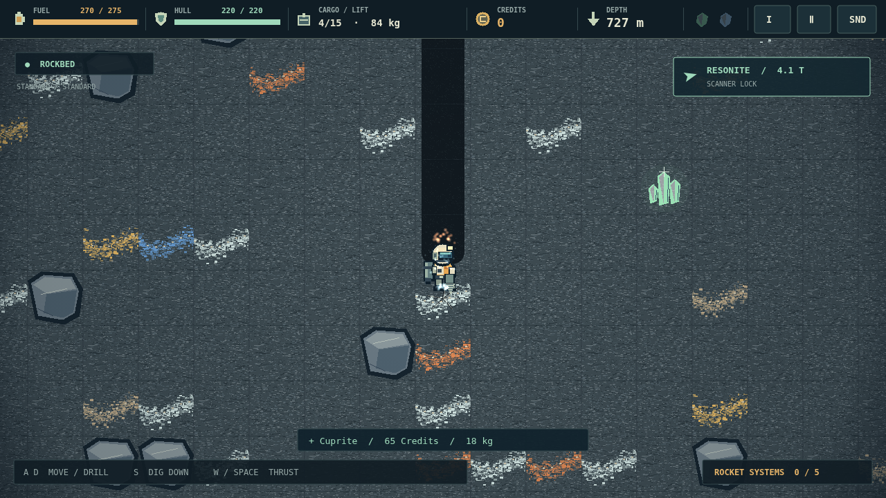

# Deepcore

One prospector. One broken dropship. An entire planet between you and a way home. Deepcore is a subterranean mining expedition where every shaft is a wager: falling is free, but the climb back costs fuel.

Cut a path through the topsoil and follow mineral seams into the dark. Your drill carves down and sideways; your jetpack is the only way up. A full cargo bay feels like a victory until the weight stops you lifting off. Keep an eye on the gauges, know when to turn around, and decide what is worth bringing home.

At the salvaged surface camp, sell your haul, patch your suit, and make your next descent a little more ambitious. Upgrade seven systems, pack emergency supplies, and piece together the five components of an escape rocket. A scanner leads you to the rare crystals that money alone cannot buy.

Below the gray rock, the planet begins to fight back. Gas breathes through innocent-looking stone. Lava churns beside your tunnels. And at the bottom, the Core offers the last piece of your rocket—with ninety seconds to get it to the launch pad. Save your progress in Standard, or make every decision final in Hardcore. The way out is down.
